  <samp>
    <a href="https://nextchat.nextsistem.dev.br">nextchat</a> &nbsp;·&nbsp;
    <a href="https://deliveryfacil.net.br">delivery fácil</a> &nbsp;·&nbsp;
    <a href="#more-projects">projects</a> &nbsp;·&nbsp;
    <a href="#stack">stack</a> &nbsp;·&nbsp;
    <a href="mailto:rudhery.hotz@outlook.com">email</a>
  </samp>

 

I'm a 17-year-old full-stack engineer shipping software that companies use every day. I care about clean architecture, fast interfaces, and the quiet polish that separates good products from great ones.

- Building **NextChat**: 60+ releases, 90+ merged pull requests, and 90 database migrations, from the Go backend to the desktop app
- Rebuilt **Delivery Fácil** from scratch with the team: 400+ commits and 100+ merged pull requests on v2, from Angular 14 to Angular 22
- Lately: Go on PostgreSQL, Angular with signals, native Windows apps on the system compositor, and AI agents that work alongside people through APIs and MCP

 

**[NextChat](https://nextchat.nextsistem.dev.br)** &nbsp;·&nbsp; private repository

One WhatsApp number, the whole team answering together. A multi-user platform with per-agent login, sectors and handoff, a built-in Kanban, scheduled messages, automations, and an integrations API with webhooks and an MCP server, so AI agents can take conversations and pass them back to the team.

<b>Go · PostgreSQL · Angular · Tailwind · Electron · Astro</b>

 

**[Delivery Fácil](https://deliveryfacil.net.br)** &nbsp;·&nbsp; private repository

Online ordering for restaurants, rebuilt from scratch. Each restaurant gets its own store with a step-by-step product builder, Pix checkout, coupons, loyalty, favorites, and live order tracking, synced in real time with the restaurant's own system and a WhatsApp bot.

<b>Angular 22 · Tailwind · .NET 8 · MySQL · Redis · RabbitMQ · SignalR · Pix</b>

 

### More projects

- **[Cay](https://github.com/Rudhery/cay)**: a native Dynamic Island for Windows on raw Win32 and `Windows.UI.Composition`, <!-- cay-releases:start -->19<!-- cay-releases:end --> releases and <!-- cay-downloads:start -->456<!-- cay-downloads:end --> downloads
- **[FolderHub](https://github.com/Rudhery/FolderHub)**: a folder is the configuration. A Windows 11 launcher that turns any folder of shortcuts into a visual hub
- **[nudge](https://github.com/Rudhery/nudge)**: a self-hosted life hub that nudges you on WhatsApp about tasks, finances, and notes
- **Legacy modernization**: moving a 10-year-old Pascal / Delphi system to the web with C# and Angular
- An **ERP / business management system**

### Stack

 

  Open to collaborations, opportunities, or tech conversations: <a href="mailto:rudhery.hotz@outlook.com">rudhery.hotz@outlook.com</a>

