<!-- Tema: troque com `python scripts/set_theme.py <noir|classic|acid|ocean|royal|terracotta>` -->
<a href="https://github.com/Rudhery">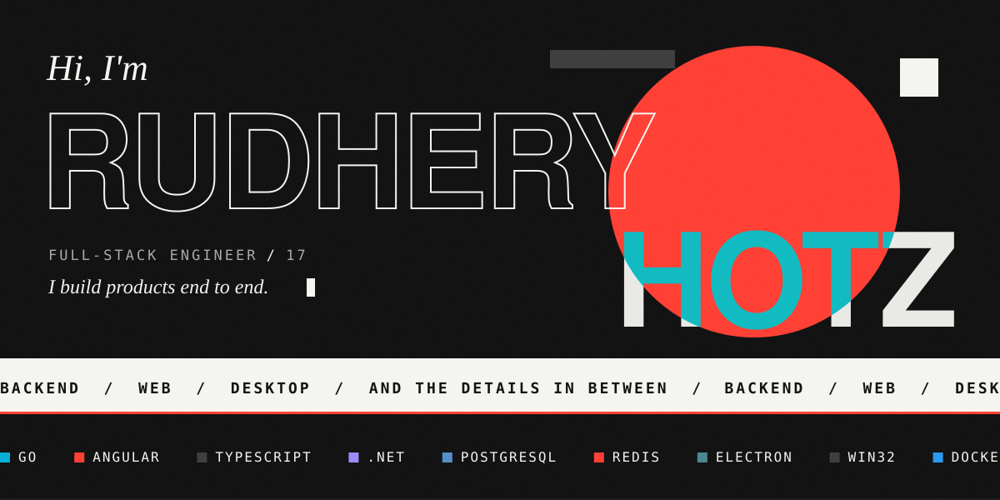</a>

  
  <a href="https://deliveryfacil.net.br">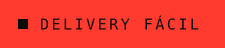</a>
  <a href="#more-projects">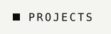</a>
  <a href="#stack">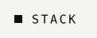</a>
  <a href="mailto:rudhery.hotz@outlook.com">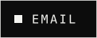</a>

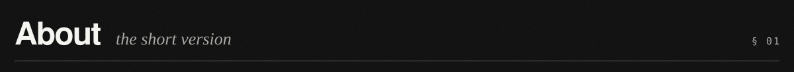
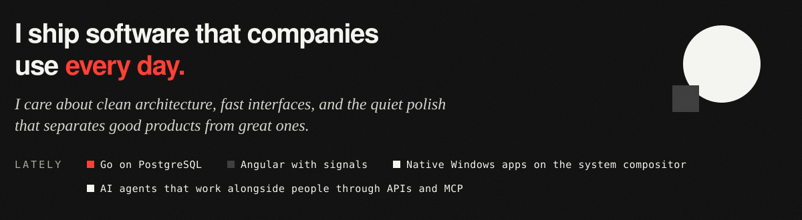

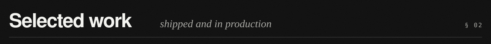
<a href="https://nextchat.nextsistem.dev.br">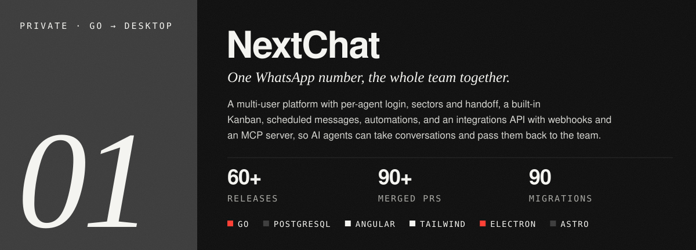</a>
<a href="https://deliveryfacil.net.br">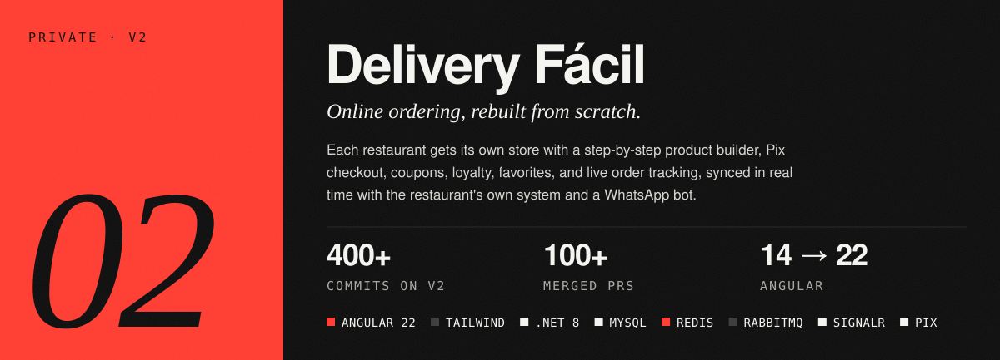</a>

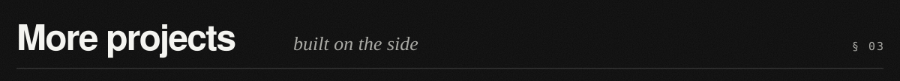
<a href="https://github.com/Rudhery/cay">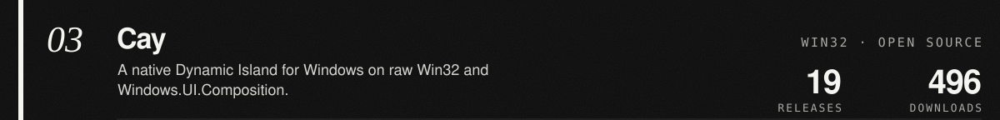</a>
<a href="https://github.com/Rudhery/FolderHub">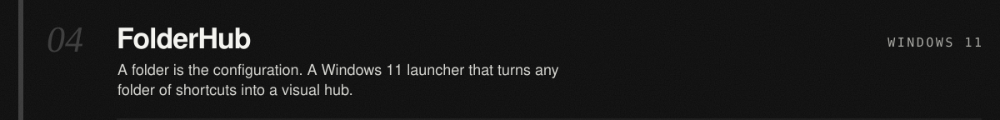</a>
<a href="https://github.com/Rudhery/nudge">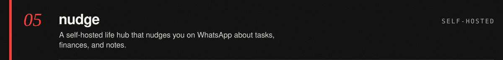</a>
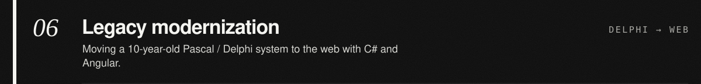
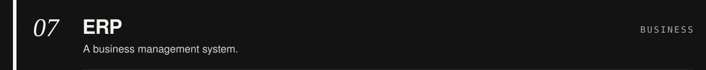

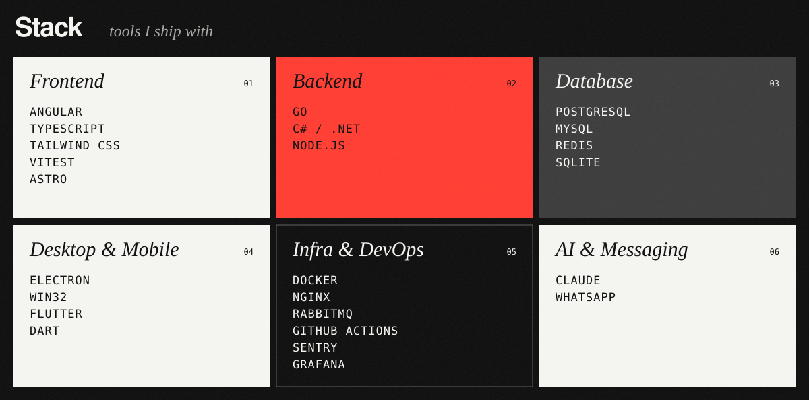

<a href="mailto:rudhery.hotz@outlook.com">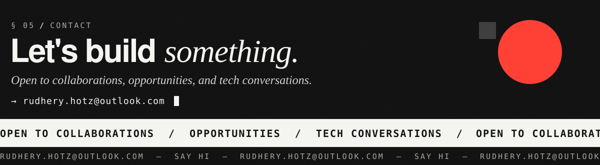</a>
